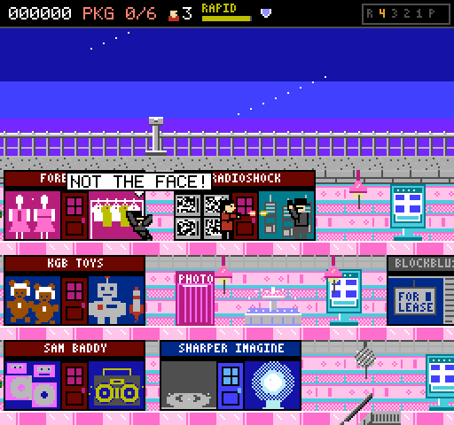
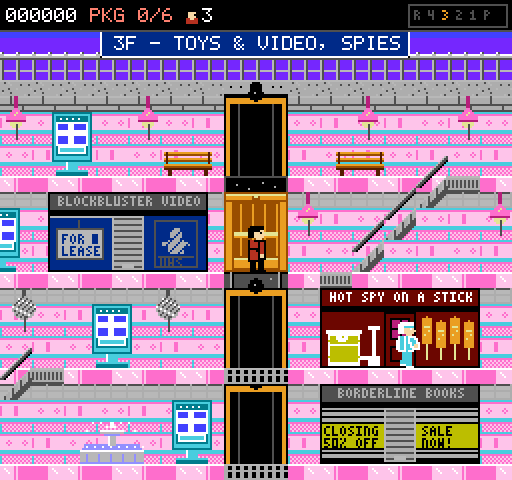
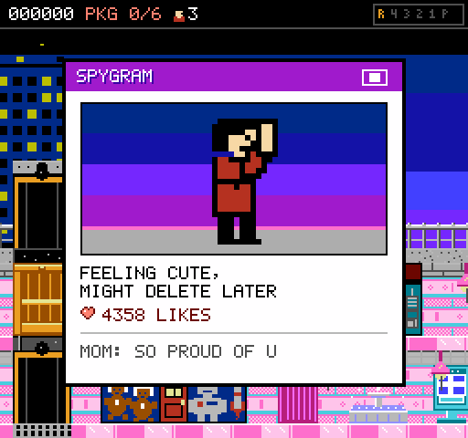

# MALL ACTION

*A SHOPPING MALL ESPIONAGE* — an 8-bit spy caper in an 80s shopping mall, by **FLICKERSOFT**.
A spiritual successor to Taito's *Elevator Action*, written in **Rust** with **Macroquad**, compiled to WebAssembly.
Every sprite, tile, font glyph, song and sound effect is generated from source code. No assets, no server.

**[▶ Play in your browser](https://rlorca.github.io/mall-action/macroquad-sonnet-5.5/)**

| | |
|---|---|
|  |  |
|  |  |
|  |  |

## The pitch

Spies have hidden **6 packages** in 6 stores of a huge 1980s mall. Zip-line onto the roof, ride elevators and
escalators down through six floors, duck into stores (the game switches to a top-down, Zelda-style room) and search
the fixtures while guards patrol. Collect all six, take the elevator to the parking level and drive away in the wood-panelled
getaway wagon. Then the next loop starts, harder.

## Features

* Side-scrolling mall (768 px, 6 floors) with three elevator shafts (two driven by you, one on a timer), two escalators,
  pits, grates, crushing, falling lamps, rolling disco balls, a janitor with a wet floor, mall walkers, a Segway mall cop,
  directory kiosks, a photo booth, fountains with coins, an alarm and PA announcements.
* 13 parody storefronts with animated window displays; 10 open stores with their own hand-designed top-down layouts,
  9 visual themes, 10 distinct songs, fitting-room surprises, wind-up toys, a listening booth and a GameStonk easter egg.
* Power-ups (rapid fire, spread shot, armour, sneakers, radar, 1-up, plus the food: Cinnabomb, Orange Juli-Ooze, Soft Pretzel).
* FLICKERSOFT splash with NES-style sprite flicker, title screen with a Konami-code **Black Friday Mode**, map overlay
  ("MALL DIRECTORY"), pause, level clear with THE DAILY MALL and a SPYGRAM post, continues (3), game over with closing shutters.
* NES-like 256×240 screen at integer scale, fixed NES master palette, ≤3 colours per sprite, arcade **CRT effect**
  (scanlines, curvature, vignette, noise; on by default), synthesised pulse/triangle/noise chiptune, keyboard + gamepad.
* Deterministic seeded randomness, fixed 60 Hz simulation, pure testable game rules (170+ tests).

## Controls

| Action | Keyboard | Gamepad |
|---|---|---|
| Move | Arrows, WASD | D-pad, left stick |
| A: shoot | Z, J | A (button 0) |
| B: jump (mall), search (store) | X, K, Space | B (button 1) |
| Select: map | Shift, Tab | Select (button 8) |
| Start: pause, confirm | Enter | Start (button 9) |
| CRT on/off | C | |
| Mute | M | |

Letter keys match the **printed letter** (QWERTZ and AZERTY work); other keys match by position.

## Tips

* **Up** enters an open store, boards an elevator that is at your floor, calls one that is not (or just stand still in
  the doorway for half a second), rides an escalator, uses a kiosk or the photo booth, and starts the getaway car.
* An open shaft with the car **below** is a pit: one floor down you land on the car roof, further is fatal. A car **above** is
  a grate you can stand on, but if it comes down you are crushed. Spies get crushed too (300 points!).
* Duck (Down) to dodge high shots, jump to dodge low shots; a jump while moving is a **jump-kick** that kills on contact.
* Shoot a hanging lamp to drop it on spies (disco balls on 2F roll!). Shoot fountains for coins. Don't shoot the mall walkers
  or fire in front of the mall cop.
* In a store, **tap X once** next to a fixture: the search runs by itself. Moving in a different direction or shooting cancels it.
* The kiosks point to the nearest package store. Radar shows package stores (and the exact fixture) with a flashing `!`.
* Try the Konami code on the title screen: ↑ ↑ ↓ ↓ ← → ← → B A (B = X key, A = Z key).

## Run, test, build

Requirements: a Rust toolchain with the `wasm32-unknown-unknown` target (`rustup target add wasm32-unknown-unknown`).

```sh
cargo test -p mall-core      # all game rules, renderer coverage, art, audio synth tests (no browser, no audio libs)
./build.sh                   # production build -> dist/ (index.html, mq_js_bundle.js, mall-action.wasm; relative URLs)
./dev.sh                     # build + serve dist/ at http://localhost:8000/
cargo run -p mall-action     # optional native window (no gamepad / storage / URL options)
cargo run --release -p mall-core --example shot -- selfie /tmp/shot.png   # render a scenario to PNG (dev tool)
```

The build works from any sub-path (e.g. GitHub Pages): all URLs are relative.

### URL options

| Option | Effect |
|---|---|
| `?seed=N` | Fixes the random seed (same seed ⇒ same game). |
| `?debug=1` | Skips the studio splash and exposes `window.mallDebug` for automated playtests: `step(frames, buttonMask)` steps the game with buttons held (bitmask `U1 D2 L4 R8 A16 B32 SELECT64 START128`; after the first call the game only advances when stepped, `resume()` restores real time), `get(i)` / `fields` read the context snapshot (scene, score, lives, floor, x, player state, ...), and `set(name, value)` is a playtest cheat (`floor`, `x`, `packages`, `lives`, `store` = teleport to a store door, `room_package`, `spy`, `kill`, ...). |
| `?gallery=1` | Shows every sprite, animated (Left/Right pages). |

## Project layout

```
core/                  mall-core: zero dependencies, runs without a browser
  src/game/            rules: level.rs (geometry, setup), mall.rs (side view), elevator.rs, store.rs + rooms.rs (top-down),
                       powerups.rs, mod.rs (flow, session, continues), tests.rs (integration tests)
  src/render/          software renderer to a 256x240 canvas (mall_view, store_view, hud, map, screens, gallery)
  src/art/             generated pixel art: chars, mall, storefronts, rooms (+ Sprites registry)
  src/audio/           NES-style synth, songs, sound effects -> 16-bit PCM
  src/flickersoft/     the reusable FLICKERSOFT splash (own README)
  src/copy.rs          ALL jokes and on-screen text (with length tests)
  src/input.rs         virtual NES pad, key mapper, tap queue, Konami detector
  src/{rng,fixedstep,pixel,font,stores}.rs
  examples/shot.rs     scenario screenshots for development
app/                   mall-action: Macroquad shell (window, CRT shader, keyboard/gamepad glue, audio playback)
web/                   index.html, mall_plugin.js (browser glue), mq_js_bundle.js (miniquad + quad-snd + plugin)
.github/workflows/     CI: test, build, publish to GitHub Pages
```

## Where to add jokes

Everything funny is in **`core/src/copy.rs`**: SPYGRAM posts, headlines, PA announcements, spy last words, elevator
lines, first-visit store lines, banners and power-up names. Add a line to an array; the tests at the bottom of that file
check it fits (bubbles ≤ 28 characters, captions/comments ≤ 21, headline lines ≤ 26, PA lines ≤ 30).

## Disclaimer

MALL ACTION is a FLICKERSOFT fan homage. It is **not affiliated with Taito or any parodied brand**. All names are puns
(FOREVER 12, RADIOSHOCK, BLOCKBLUSTER VIDEO, ...); there are no real logos, trade dress or brand names.

## Benchmark notes

Part of the "same one-shot prompt, different models" benchmark (see `main`).

* **Model:** Claude Sonnet 5.5 (`claude-sonnet-5-5`)
* **Date:** 2026-11-15
* **Harness:** Claude Code (CLI), one long autonomous session (several hours of wall-clock time). Reasoning effort: the
  session default (not raised). The art and audio modules (`core/src/art/*`, `core/src/audio/*`) were written by five forked
  sub-agents of the same model running in parallel git worktrees (chars/items, mall environment, storefronts, top-down rooms,
  chiptune audio); everything else was written in the main session.
* **Deviation from the verbatim prompt:** the user asked for the implementation to be written in **Rust with Macroquad**
  (the prompt leaves the technology open) and for the branch to be named `macroquad-sonnet-...`.
* **Interventions:** none beyond that request. The model consulted an `advisor` tool (a stronger reviewer model that sees
  the transcript) at the start and before finishing; its review led to the CRT-edge fix, the debug setters, the per-game
  flags and the npm wrappers. `.github/workflows/pages.yml` was adapted from an existing implementation branch (as the repo's
  AGENTS.md prescribes); no game code from other branches was read.
* **Verification:** `cargo test -p mall-core` (176 tests incl. navigation, fairness and renderer-coverage tests), native PNG
  screenshots, and a headless-Chrome (CDP) playtest of the real wasm build with the CRT on, served from a sub-path:
  splash, title (CRT/mute toggles with real key events), zip-line arrival and selfie, elevator and escalator rides, shooting a
  spy and a lamp, entering a store, searching and finding a package with guards alive, map, pause, level clear (tally,
  headline, post) into loop 2, continue, game over back to the title, a 45-60 s random-input soak, a gallery page, and a
  devicePixelRatio-2 / resized-window check. No console errors. Not verifiable in that environment: real audio output
  (synthesis is tested for level/determinism/looping; it was never *listened to*), real gamepads, and non-QWERTY hardware.
* **Architecture note:** because Macroquad has no gamepad/URL/localStorage APIs, a small miniquad JS plugin
  (`web/mall_plugin.js`) provides them; the game is rendered by a pure-Rust software renderer into a 256×240 RGBA canvas
  that the shell uploads as a texture, so rules *and* rendering are testable natively.
