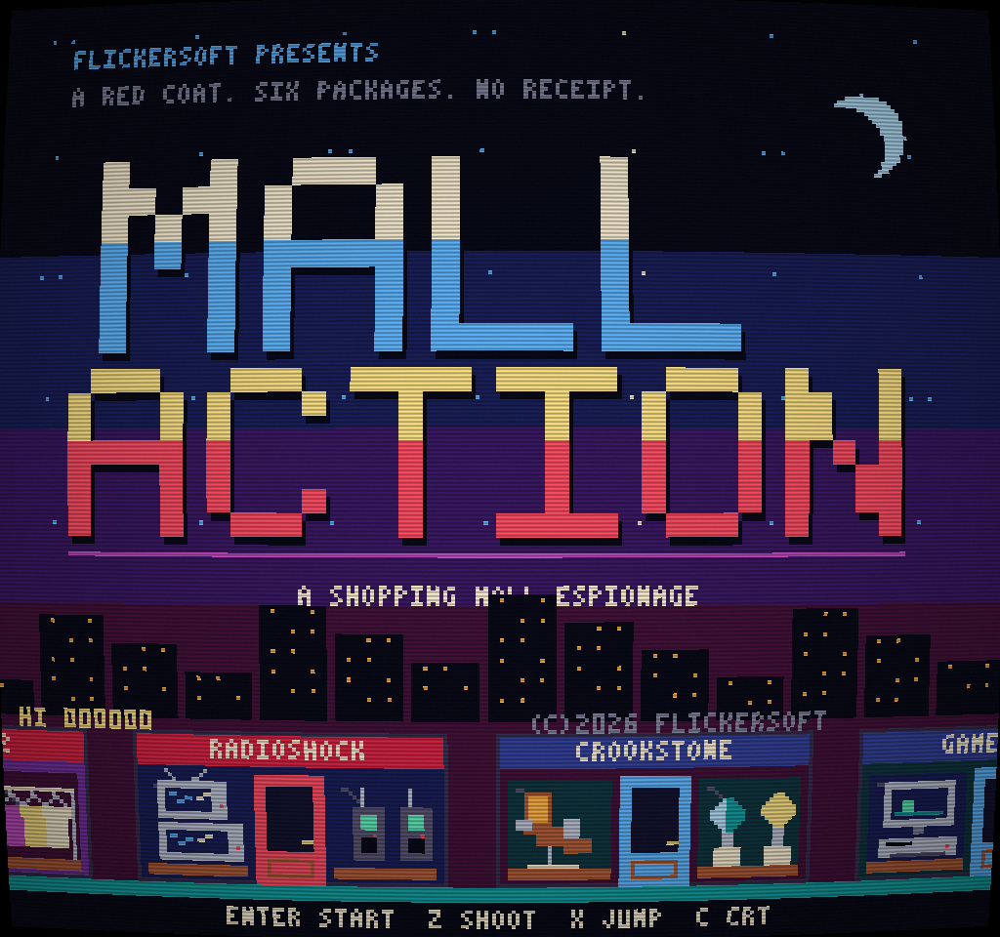
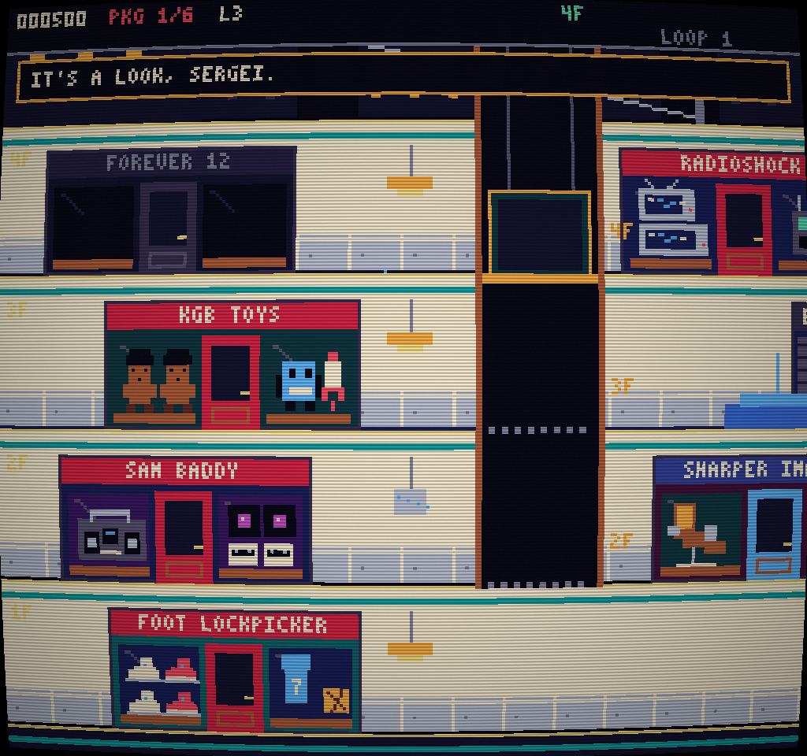
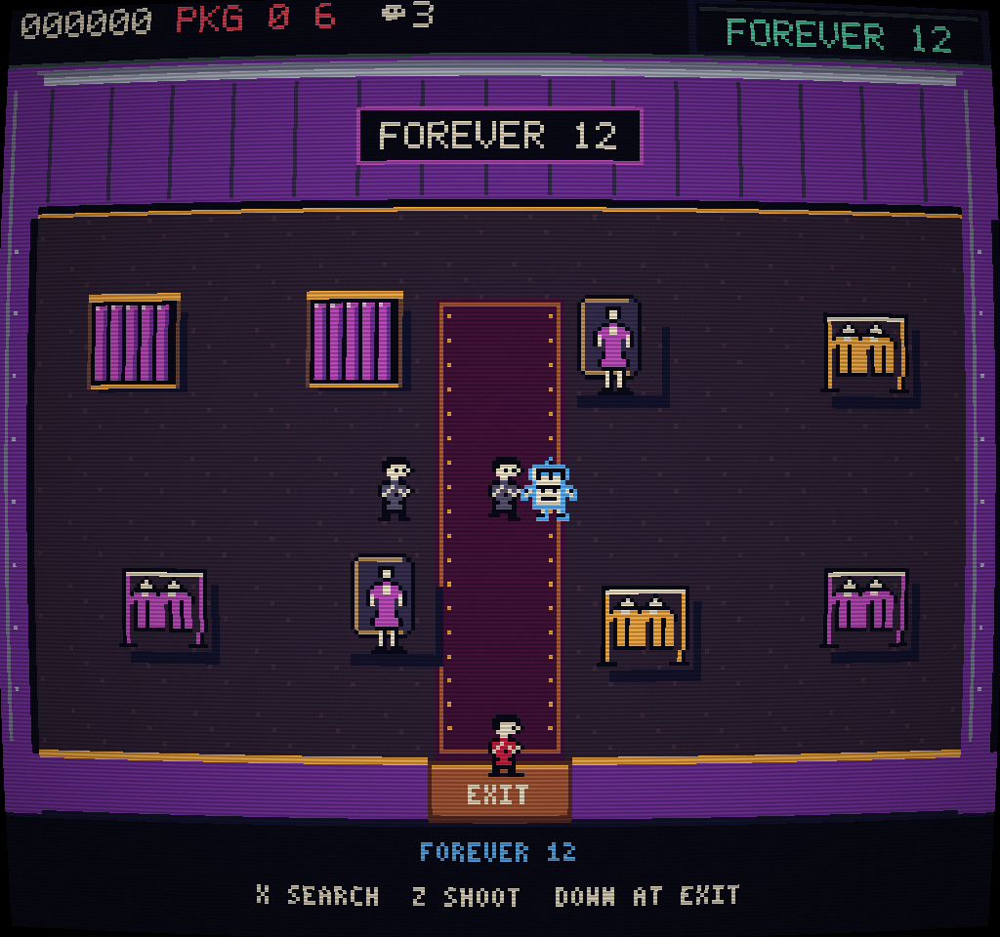

# MALL ACTION — Rust edition

**A red coat. Six packages. No receipt.** An original, browser-playable 8-bit shopping-mall spy caper by fictional studio FLICKERSOFT. A pure Rust simulation and pixel renderer compile to WebAssembly; a small JavaScript adapter handles the browser, WebGL CRT and synthesised four-voice audio.

[Play in your browser](https://rlorca.github.io/mall-action/rust-gpt-6.1-sol-medium/)





## Play

Search the six blinking red-door stores, collect their packages, then find elevator B and ride down to P. Use the wood-panelled getaway wagon to escape. The next loop is harder. Blue doors offer power-ups; shuttered businesses are closed.

| Action | Keyboard | Gamepad |
|---|---|---|
| Move / interact | Arrows or WASD | D-pad / left stick |
| Shoot | Z or J | A |
| Jump / search | X, K or Space | B |
| Directory map | Shift or Tab | Select |
| Start / pause | Enter | Start |
| CRT | C | — |
| Mute | M | — |

Press any key or click the game to unlock audio. The title has a heroic score, the mall has deliberately quiet ambience, every open store has its own song, and elevator rides switch to muzak. M toggles sound. Audio failure never blocks gameplay.

Tips: tap X once beside a fixture and let the search finish. Moving in a new direction or shooting cancels it. Elevator A serves R–2F; B serves 4F–P; C serves R–1F. Release a manual car between floors and it glides to the next stop. Step out sideways at a floor. An empty opening can call its car; wait beside it or press Up/Down. Shoot lamps, duck high shots and try a moving jump-kick. The photo booth hides you. The directory pauses the game. There are three continues.

Enter Up Up Down Down Left Right Left Right X Z on the title for Black Friday Mode.

## Run, test and build

Requirements: Rust stable with `wasm32-unknown-unknown`, Node 20 or later. No third-party Cargo or npm dependencies.

```sh
rustup target add wasm32-unknown-unknown
npm ci
npm test
npm run build
npm run dev
```

Open http://127.0.0.1:4176/. `npm run build` outputs static files in `dist/`; all asset references are relative, including the Wasm fetch. Runtime assets use content-hashed filenames, so published artwork changes load without stale browser caches. Serve the directory over HTTP, rather than opening its HTML with `file://`.

The production build is about 100 KB of Wasm, plus source JavaScript and HTML. Pixels, fonts, sprites and music are source-defined; there are no external art/audio files.

`npm test` runs Rust unit/integration tests and Node tests for browser input, scheduling and music data. Tests include deterministic replay, the full six-package progression, room navigation, elevators, searching, NPCs, scoring, power-ups, continue/game over, copy limits and rendering every scene. `scripts/playtest.js` is an async Playwright-page function used for real keyboard/browser QA; it writes screenshots to `/tmp/mall-*.png`. Evaluate it with a Playwright `page` while the dev server is running. It deliberately combines real-time input with debug positioning/stepping for later progression.

## Debug options

- `?seed=123`: reproducible world and random decisions.
- `?gallery=1`: animated four-page actor/prop atlas, automatically cycling every eight seconds.
- `?debug=1&seed=123`: skip splash and expose `window.game`.

```js
game.state                  // scene, player, score, packages, timers and flags
game.fixtures               // current room's fixture positions and contents
game.audio                  // current track, context state and measured RMS
game.freeze()               // suspend real-time simulation for inspection
game.step(60, game.buttons.RIGHT)
game.freeze(false)
```

`game.command(op,a,b)` provides test setup: 0 resets the mall; 1 positions the player at floor `a`, x `b`; 2 enters store `a`; 3 positions inside a room; 4 inflicts damage; 5 marks all packages; 6 grants power-up `a`; 7 triggers continue; 8 triggers game over; 9 spawns a spy using ordinary spawning rules; 10 positions car `a` at floor `b`. These commands are gated in Rust as well as JavaScript by `debug=1`. Scene IDs are Splash 0, Title 1, Arrival 2, Selfie 3, Mall 4, Store 5, Clear 6, News 7, Post 8, Continue 9, Over 10.

## Source layout

- `src/game.rs`: pure deterministic simulation, collision, room plans and AI.
- `src/art.rs`: palette, bitmap fonts, sprites and clipped framebuffer primitives.
- `src/pixel.rs`: explicitly authored pixel-row atlas for actors, clothing, electronics, toys, food, furnishings and mall architecture. Each stamp uses three inks plus transparency.
- `src/render.rs`: immutable-state drawing, HUD, CRT-ready scenes and directory.
- `src/copy.rs`: jokes, SPYGRAM posts, first-visit lines, headlines and item names. Add jokes here; tests enforce the copy limits.
- `src/splash.rs`, `splash/README.md`: reusable FLICKERSOFT timing module.
- `src/lib.rs`: dependency-free Wasm ABI; Rust owns the framebuffer and state.
- `browser.js`: input edge queue, fixed-step clock, WebGL post-effect and persistence.
- `audio.js`: browser audio graph, effect envelopes, mute and state changes.
- `score.js`, `synth.js`, `synth-worklet.js`: original arrangements and a sample-clock sequencer on the audio thread; two band-limited pulse voices, triangle bass and filtered noise.
- `src/collision.rs`: shared actor feet, hurt boxes, bullet bounds and platform sweep geometry.
- `tests/`: native mission/navigation integration tests and browser-adapter tests.

Simulation runs at 60 Hz with integer coordinates. Rendering is decoupled, catch-up is bounded, and random choices are simulation-owned. Map/pause stop rule timers. The source framebuffer stays 256×240; the browser scales by integer factors and uploads with nearest-neighbour filtering. C toggles a persistent scanline/curvature/vignette/noise shader.

## Publishing

`.github/workflows/pages.yml` runs `npm ci`, `npm test` and `npm run build` on pushes to `rust-gpt-6.1-sol-medium`. It publishes only this build's folder on `gh-pages`, shares the repository's `pages-publish` concurrency group, and adds a landing-page link idempotently. A failed test blocks publishing. Other model branches and their histories remain independent.

## Benchmark notes

- Requested benchmark label: GPT-6.1 Sol (`gpt-6.1-sol`), medium. Runtime model/effort metadata was not independently introspected.
- Date: 2026-11-14. Harness: Codex desktop, local macOS workspace and browser automation.
- Duration: approximately 45 minutes for implementation, visual/audio revision and verification.
- This is a **Rust-constrained, interactively revised run**, not a strict unchanged-prompt one-shot. The shared brief was read unchanged. The user required Rust and the exact branch name, criticised the first graphics pass, reported missing music, requested a look at the published Sonnet–Fable version, and asked for a more ambitious visual result. That version was viewed in the browser as a visual reference; its source/art/audio were not copied.
- Environment interventions: an isolated Rust toolchain and Wasm target were installed under `/tmp` because the system compiler lacked the target; native approvals were needed for Git worktree writes, downloads and the local server.
- Browser QA: CRT enabled; real keyboard elevator ride, store entry, one-tap search, package acquisition, exit, map, pause and escalator; deterministic/debug completion of remaining packages, escape, loop 2, continue and game over. Audio checked using a running Web Audio context and nonzero analyser output. Screenshots were captured and visually inspected.

### Collision and audio revision

Further user playtesting exposed collision and music problems despite the original passing checks. This revision gives store movement a dedicated foot box, gives bullets their own swept bounds, fixes roof-to-floor landings and moving-car boarding, prevents entrance/exit bouncing, and resolves fatal falls immediately. Shop depth ordering now follows feet and furniture edges.

Music now runs from the audio sample clock in an AudioWorklet, independently of rendering. The arrangements have explicit major/minor chord voicings, softer band-limited pulse tones, filtered percussion and smooth transitions. In the browser, music continued through a deliberate 750 ms main-thread stall; mute also worked while game frames were frozen. The revised suite has 72 automated tests, with focused collision and waveform regressions plus real-keyboard playtests.

To audition a score offline from the production synthesizer:

```sh
node scripts/render-audio.mjs title /tmp/mall-title.wav 12
```

### Art revision

Following further user feedback, a separate revision replaces the original geometric placeholder art with a source bitmap atlas, drawn actor poses, 5×7 storefront lettering, distinct material tiles, shop furniture, and detailed mall props. The original commits remain in history. The revision keeps the simulation unchanged and passes 48 automated tests plus the real-browser mission playtest with CRT enabled. Screenshots above show the revised artwork.

A FLICKERSOFT fan homage, not affiliated with Taito or any parodied brand.
