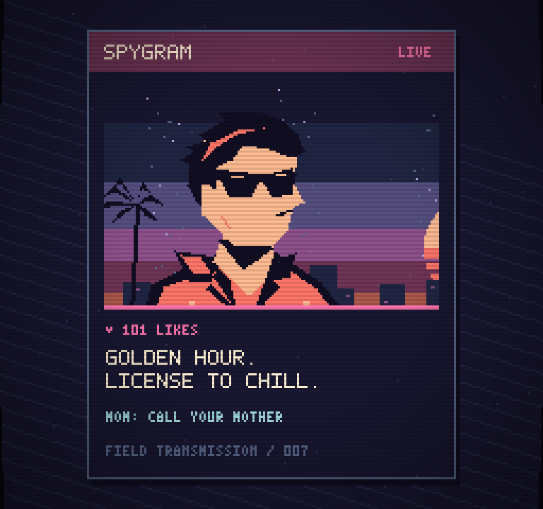
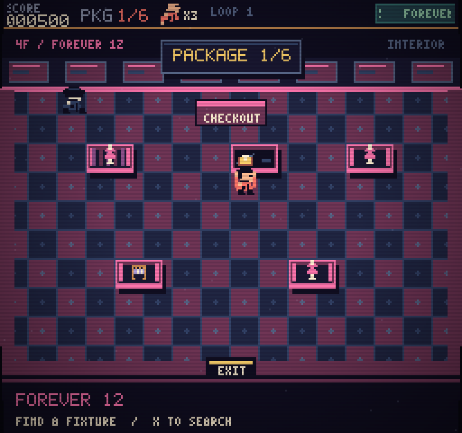
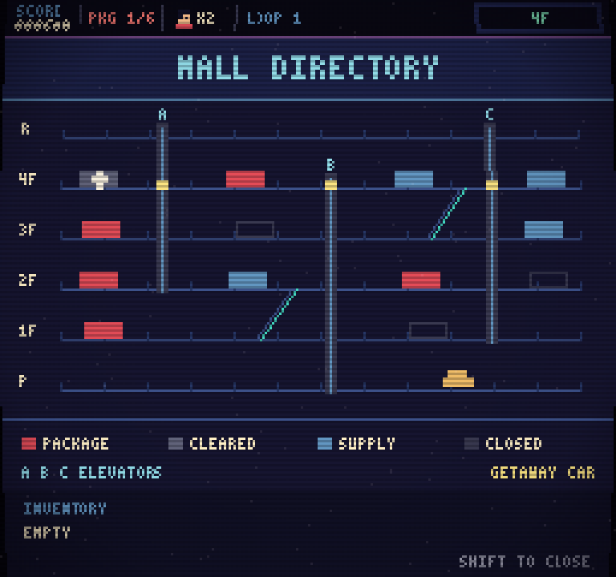

# Mall Action

Zip-line onto a shopping mall, dodge the men in fedoras, and find six packages before security closes in. Your getaway car is a wood-panelled station wagon. Your first mistake was posting the selfie.

**[Play in your browser](https://rlorca.github.io/mall-action/gpt-6.2-astra-xhigh/)** · [Run locally](#run-locally)


## The mission

Drive elevators through a three-screen-wide mall. Red doors lead to top-down search rooms, blue doors to upgrades. Shoot the lamps, jump-kick the spies and watch the wet-floor signs. Complete the mission to make the front page of *The Daily Mall* and start a harder loop.

The game draws its own sprites, signs, portrait and bitmap fonts at 256 × 240. The Web Audio score changes with the store, alarm, elevator and listening booth. Scanlines, curvature, vignette and noise are enabled on first visit.

| Rooftop arrival | Mall corridors |
| --- | --- |
|  |  |
| **A fitting-room search** | **Package secured** |
|  |  |

## Controls

| Action | Keyboard | Standard gamepad |
| --- | --- | --- |
| Move, aim in a store | Arrow keys or WASD | D-pad or left stick |
| Call, board, drive, enter, interact | Up / Down | Up / Down |
| Shoot | Z or J | A |
| Jump or search | X, K or Space | B |
| Directory | Shift or Tab | Select |
| Start, pause, continue, advance a result screen | Enter | Start |
| CRT / mute | C / M | |

Letter bindings follow the printed key. Press a key or gamepad button to unlock sound.

## Field tips

- At the roof landing, walk left to shaft A. Hold Down to board and descend. Release between floors to coast to the next stop, then walk sideways to exit.
- Wait beside an empty shaft or press Up to call the car. A car below the opening leaves a pit.
- Start at Forever 12 on 4F. Walk against a fixture and tap X once. The progress bar fills by itself. Leave through the bottom-center exit.
- Tap Select to study the directory. Shaft B is the only route to parking. Approach the station wagon with all six packages and press Up.
- A moving jump becomes a kick. Duck under high shots. A standing shot can bring a ceiling light down on a pursuer.
- Visit GameStonk for a dubious investment. Try the Konami code on the title screen for Black Friday.



## Run locally

Open `index.html` directly in a modern desktop browser, or use Node.js 22+ and npm.

```sh
npm ci
npm run dev
npm test
npm run build
```

The dev server listens at `http://127.0.0.1:4173`. The production build writes a self-contained `dist/` folder with relative script URLs. Open `dist/index.html` or serve that folder at any path. There are no runtime dependencies.

## Replays and diagnostics

- `?seed=17` selects a deterministic world.
- `?debug=1&seed=17` skips the splash and exposes `window.mall`. Use `mall.state` to inspect the running game. Call `mall.setManual(true)` to suspend real-time updates, then `mall.step(1, ["start"])` or `mall.step(60, ["right", "a"])`. The first listed button receives one fresh press, and all listed buttons stay held for those frames. Resume with `mall.setManual(false)`.
- `?gallery=1` cycles through pages of source-generated sprites.

## Project layout

| Path | Contents |
| --- | --- |
| `src/rules.js`, `src/data.js` | Frame simulation, mall geometry, room templates and loot |
| `src/copy.js` | Shop names, interface text, guard dialogue, jokes, PA notices and SPYGRAM posts |
| `src/art.js`, `src/render.js` | Palette, bitmaps, fonts, scene drawing and camera |
| `src/audio.js` | Original sequencer patterns, envelopes, oscillators and noise |
| `src/input.js`, `src/main.js` | Virtual pad, fixed timestep, browser integration and CRT |
| `splash/` | Reusable FLICKERSOFT studio ident and integration notes |
| `test/` | Rule tests plus a full seeded mission driven entirely by virtual pad inputs |
| `scripts/`, `.github/workflows/` | Local serving, static build and test-gated Pages publishing |

## Benchmark notes

- Model identifier supplied for the run was `GPT-6.2-astra`, with `xhigh` effort.
- Built November 18, 2026, in Codex, with local Codex CLI 0.169.0. The implementation and local verification took roughly half an hour.
- The run started on an empty orphan branch. Repository guidance and the model/effort naming instruction were present in the session. The shared prompt was the only existing repository file read.
- The harness handled permission reviews for Git, loopback serving and formatting. No human design changes or hints were supplied during implementation.
- Chromium playtests used real keyboard input with CRT enabled. Debug fixtures staged selected encounters and end screens. A separate deterministic run traverses the roof, six target stores, both escalator connections as needed, and the parking exit, using ordinary controller inputs.

A FLICKERSOFT fan homage. Unaffiliated with Taito or any parodied brand.
