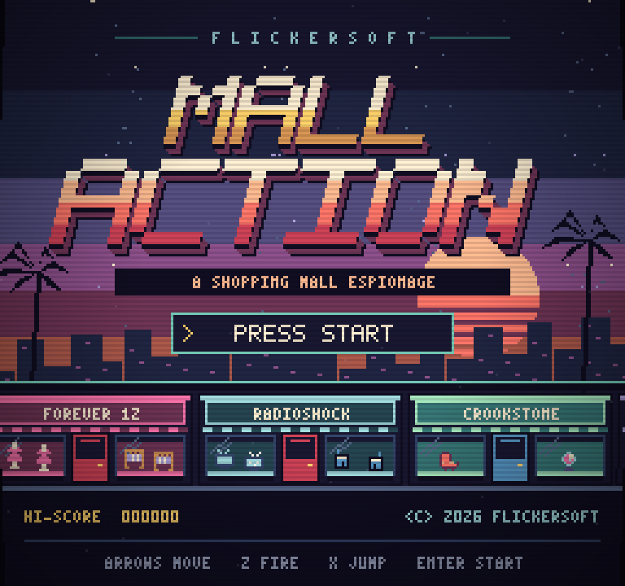
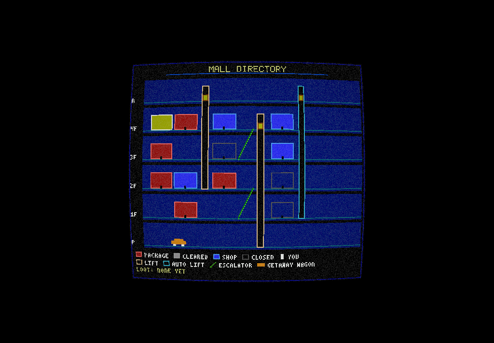
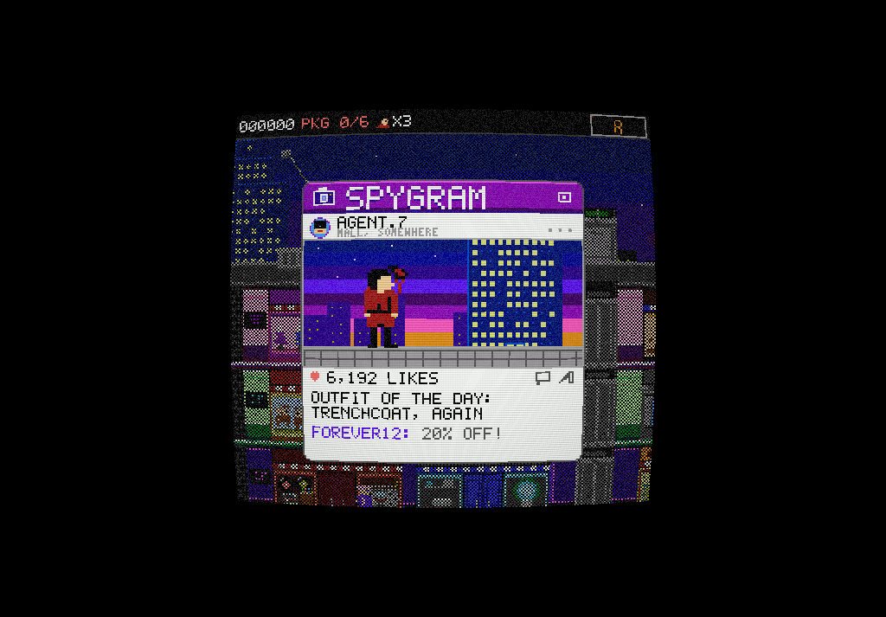

# MALL ACTION

An 8-bit spy caper in an 80s shopping mall, by **FLICKERSOFT**: a spiritual successor to *Elevator Action*,
written in **Rust** with **Bevy** and played in the browser.

Spies hid **6 packages** in 6 stores. Ride the elevators and escalators of a side-scrolling mall, dodge and
shoot the spies, duck into stores (top-down, Zelda-style) to search fixtures for the packages, then reach the
parking level and drive off in the wood-panelled getaway wagon. Then the next loop starts, harder.

**Play in your browser:** https://rlorca.github.io/mall-action/bevy-sonnet-5.5/

| | |
|---|---|
|  |  |
|  |  |
|  |  |

## Features
- Side-scrolling mall: 6 floors, three elevator shafts (two manual, one automatic), two escalators, zip-line
  arrival and a SPYGRAM selfie, spies that telegraph their shots, hanging lamps and disco balls you can shoot,
  a janitor's wet floor, mall walkers, a Segway mall cop, fountains, photo booth, directory kiosks, an alarm
  and the mall PA.
- 13 parody storefronts with animated windows; 10 top-down stores, each with its own layout, theme tiles,
  guards, jokes and its own chiptune song.
- Power-ups (Rapid Fire, Spread Shot, Armor Vest, Sneakers, Radar, 1-Up and the food: Cinnabomb, Orange
  Juli-Ooze, Soft Pretzel), loops that get harder, 3 continues, THE DAILY MALL front page, SPYGRAM posts.
- Everything is generated from code: sprites (ASCII art, max 3 colours + transparent per sprite, NES palette),
  fonts, and the music/sound (two pulse waves, triangle and noise synthesised sample by sample).
- Optional CRT effect (scanlines, curvature, vignette, noise), on by default.
- Secret: enter the Konami code on the title screen. Black Friday!

## Controls
| Action | Keyboard | Gamepad |
|---|---|---|
| Move | Arrows, WASD | D-pad, left stick |
| A: shoot | Z, J | A |
| B: jump (mall), search (store) | X, K, Space | B |
| Select: map | Shift, Tab | Select |
| Start: pause, confirm | Enter | Start |
| CRT on/off | C | |
| Mute | M | |

Letter keys match the printed letter, so QWERTZ and AZERTY work.

## Tips
- Up/Down at a store door enters it. Target stores have blinking **red** doors, power-up shops **blue**.
- Stand in an empty elevator opening for half a second to call the car. Never stand under a car on a grate.
- Hold Down to duck high shots. A jump while moving is a jump-kick.
- In a store a single tap of B searches the fixture you are touching. The Radar power-up marks packages.
- Select shows the MALL DIRECTORY map.

## Run, test, build
Needs Rust (stable) with the `wasm32-unknown-unknown` target and the `wasm-bindgen` CLI **exactly 0.2.130**
(`cargo install wasm-bindgen-cli --version 0.2.130 --locked`).
```
cargo test -p mall-core -p mall-splash   # all game rules, art, audio, screens (no browser, no Bevy)
./build.sh                               # production build into dist/ (static files, relative URLs)
./serve.sh                               # build + serve http://localhost:8000/
```
Debug URL options: `?seed=N` fixes the random seed; `?debug=1` skips the splash and exposes
`window.mallDebug` (`step(frames, heldMask)`, `state()`, `cmd("packages" | "clear" | "warp 1 300" | "store 4" |
"kill" | ...)`, `resume()`, `fbHash()`); `?gallery=1` shows every sprite, animated (Left/Right pages).

## Project layout
- `core/` (`mall-core`): zero dependencies. `mall/` side-scroller rules + drawing, `store/` top-down rooms,
  `screens/` title/HUD/map/pause/level clear/continue/game over, `game.rs` scene machine, `art/` sprites,
  tiles and storefronts, `audio/` synth + songs + sfx, `copy.rs` **all jokes**, `input.rs`, `pixel.rs`, `run.rs`.
- `splash/` (`mall-splash`): the reusable FLICKERSOFT splash module (own README).
- `app/` (`mall-app`): the Bevy shell: window, keyboard/gamepad, CRT shader, audio output, JS debug hooks.
- `.github/workflows/pages.yml`: test, build, publish to GitHub Pages.

## Adding jokes
Everything lives in `core/src/copy.rs` (SPYGRAM posts, last words, store lines, PA, headlines...). Add a line to
the array; the tests at the bottom check it fits on screen.

## Disclaimer
A FLICKERSOFT fan homage. Not affiliated with or endorsed by Taito or any parodied brand; all names are puns.

## Benchmark notes
- Model: Claude Sonnet 5.5 (`claude-sonnet-5-5`), Rust + Bevy 0.20 variant of the one-shot prompt; 2026-11-15.
- Harness: Claude Code, default effort; the lead session orchestrated 8 subagents (art x2, audio, mall x2,
  store, screens x2) working in `core/` modules against shared interface skeletons.
- Interventions: none steering the design. Not verified by a human: the music/sound was never listened to
  (checked by analysis only); no real GPU or gamepad was used (headless Chrome with SwiftShader).
