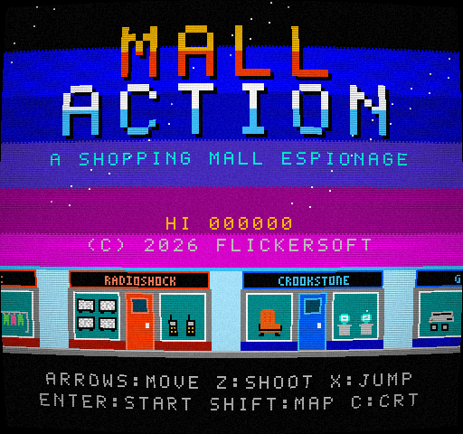
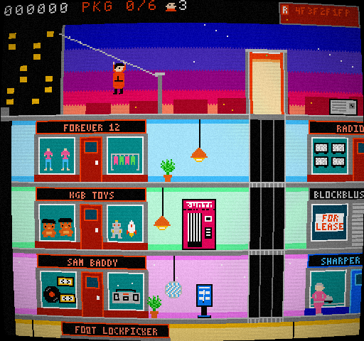
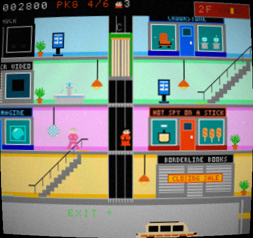
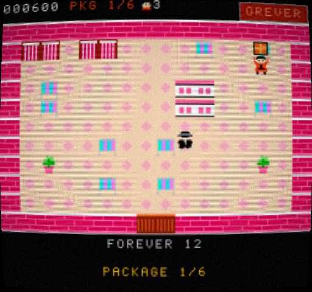
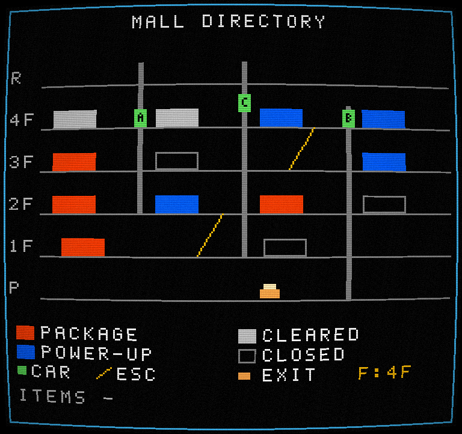
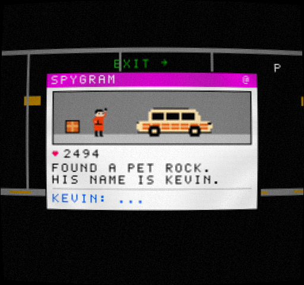

# MALL ACTION

**An 8-bit spy caper in an 80s shopping mall.** A FLICKERSOFT game.

Zip-line onto the roof of the mall, ride the elevators, dodge spies in fedoras, search six stores for
six hidden packages, and drive away in a wood-panelled station wagon. Then do it again, harder.
*Mall Action* is a spiritual successor to Taito's *Elevator Action* (1983): the mall is a side-scroller,
and walking into a store flips the game into a top-down, Zelda-style room.

### ▶ [Play in your browser](https://rlorca.github.io/mall-action/fable-5.2/)

No install, no server: it is a handful of static files. Everything you see and hear (sprites, tiles,
fonts, music, sound effects) is generated from source code.

| | | |
|---|---|---|
|  |  |  |
|  |  |  |

## Features

- **A 3-screen-wide, 6-floor mall** (R, 4F, 3F, 2F, 1F, P) with three elevator shafts that do not all
  reach every floor, two escalators, and 13 parody storefronts whose animated window displays show
  what they sell.
- **Elevators with teeth:** drive them yourself, call them, ride on their roofs, fall down their pits,
  and crush spies who wait on the grates.
- **10 top-down store rooms** in 9 visual themes, each hand-laid-out, with guards, security bots,
  traps, power-ups and exactly one package per target store.
- **Store extras:** occupied fitting rooms, wind-up toys, a listening booth with a B-side, and a certain
  cave scene in GameStonk.
- **A living mall:** a janitor and his wet floor, power-walking retirees, a mall cop on a Segway,
  fountains full of coins, a photo booth, directory kiosks, shootable lamps and rolling disco balls.
- **9 power-ups**, three of them food.
- **Chiptune soundtrack** on two pulse channels, a triangle and noise: a title theme, a quiet mall bed,
  an alarm groove, elevator muzak and one distinct song per store.
- **CRT post-effect** (scanlines, curvature, vignette, noise), on by default.
- **Jokes.** SPYGRAM selfies, THE DAILY MALL, PA announcements, last words.
- Keyboard (any layout) and gamepad. Fixed 60 Hz simulation, seeded and deterministic.

## Controls

| Action | Keyboard | Gamepad |
|---|---|---|
| Move | Arrows, WASD | D-pad, left stick |
| A: shoot | Z, J | A (button 0) |
| B: jump (mall), search (store) | X, K, Space | B (button 1) |
| Select: map | Shift, Tab | Select (button 8) |
| Start: pause, confirm | Enter | Start (button 9) |
| CRT on/off | C | |
| Mute | M | |

**Up or Down** does whatever fits where you stand: enter a store at its door, board or drive an
elevator, ride an escalator, use a kiosk, the photo booth or the getaway car.

## Tips

- Red blinking doors hide a package. Blue doors are power-up shops. Shutters are closed for good.
- Spies telegraph every shot for half a second. They aim **high** (duck) or **low** (jump).
- Your bullets are twice as fast as theirs. A moving jump is a jump-kick.
- An empty shaft opening is either a grate (car above: safe to stand on, until the car comes down)
  or a pit (car below). Stand still next to it for a moment, or press Up, and the car comes to you.
- A standing shot hits hanging lamps; duck to shoot underneath them. On 2F they are disco balls.
- In a store, touch a fixture and tap X once. You do not need to hold it.
- Guards announce a shot with a "!" - step out of their line.
- Do not shoot in front of the mall cop. Or the mall walkers. They were here first.
- Shift opens the mall directory; kiosks point at the nearest package.
- All six packages? Shaft **B** is the only way down to parking (P).
- On the title screen, a certain famous code starts the sales early.

## Run, test, build

Requires Node 22.12 or newer (the test runner's minimum). Developed on Node 26; CI uses Node 22.

```sh
npm install
npm run dev        # dev server with hot reload
npm test           # the rule tests (Vitest, no browser needed)
npm run build      # type-check, then build static files into dist/
npm run preview    # serve dist/ locally
```

`dist/` uses relative URLs, so it works from any sub-path
(for example `https://user.github.io/mall-action/`).

Two dev helpers render straight from the rules to PNG files, without a browser:

```sh
npm run shot out.png             # sprite gallery
npx tsx scripts/scenes.ts shots  # ~40 scenes: title, every floor, every store, map, clear...
```

### Debug URL options

| Option | Effect |
|---|---|
| `?seed=N` | fixes the random seed: the same seed and inputs always replay the same game |
| `?debug=1` | skips the studio splash and exposes `window.__mall` (see below) |
| `?gallery=1` | shows every sprite, animated (Up/Down scrolls) |

With `?debug=1`:

- `__mall.game` is the whole game state (plain data).
- `__mall.step(n, held, pressed)` steps the rules `n` frames with the `held` button mask;
  `pressed` is applied on the first frame only. Masks are in `__mall.Btn`
  (`Up 1, Down 2, Left 4, Right 8, A 16, B 32, Select 64, Start 128`).
- `__mall.setPaused(true)` stops the real-time loop so only `step` advances the game.
- `__mall.state()` returns a small summary.

### Continuous integration

`.github/workflows/pages.yml` runs on every push to this branch: `npm ci`, `npm test`,
`npm run build`, and only if all pass publishes `dist/` to the `fable-5.2/` folder of the
`gh-pages` branch. Failing tests block the deploy. (The brief asks for "every push to `main`";
in this repository each implementation lives on its own branch, so the trigger is this branch.)

## Project layout

```
index.html              the page: one canvas
src/
  main.ts               browser bootstrap: input, loop, presenter, audio, debug hook
  core/                 fixed-step loop, seeded RNG, virtual NES pad (pure)
  game/                 THE RULES (pure, no DOM): see AGENTS.md
    copy.ts             every line of text and every joke
    level.ts            the mall layout (floors, shafts, stores, props)
    rooms.ts            store room templates
    mall.ts store.ts    side-scrolling and top-down rules
    game.ts             screens and flow; setup.ts, powers.ts, types.ts
  gfx/                  palette, pixel-art pipeline, framebuffer, fonts, sprites, props
  render/               draws the state into the framebuffer (never changes it)
  audio/                WebAudio synth, songs and sound effects as data
  platform/present.ts   WebGL presenter: whole-number scaling and the CRT shader
  flickersoft/          the reusable studio splash (own README)
tests/                  Vitest suites and the scripted bot that plays whole games
scripts/                PNG dump helpers
```

## Where to add jokes

All copy lives in [`src/game/copy.ts`](src/game/copy.ts): SPYGRAM posts, store lines, last words,
elevator small talk, PA announcements, headlines, joke items. Add a line to the right list and run
`npm test`: `tests/copy.test.ts` checks that every line fits on screen (speech bubbles 28 characters,
SPYGRAM captions 2 lines of 21, comments 21, headline lines 26) and that every character has a glyph.

## Benchmark notes

This branch is one entry in a benchmark: the same one-shot prompt (`one-shot-prompt.md` on `main`)
given to different AI models.

| | |
|---|---|
| Model | Claude Fable 5.2 (`claude-fable-5-2`) |
| Date | 2026-11-10 |
| Harness | Claude Code 2.1.322 (CLI), with its advisor tool enabled |
| Reasoning / effort setting | the session context showed a reasoning-effort value of 10 late in the run; the label was not otherwise visible to the model, so the operator should confirm it |
| Wall-clock time | about 1 hour 15 minutes (08:02 to about 09:15 CET), including tests, browser playtests and docs |
| Human interventions | none. The user asked one question mid-run (how the game was being play-tested); it was answered and did not steer the work |

Things a careful reader should know about how this run differed from the protocol:

- **Not an empty directory.** The run happened in a git worktree of the benchmark repository, on a new
  orphan branch. The user's instruction was "follow the instructions on main, create a dedicated
  branch, implement the prompt; don't look at the other implementations". No other implementation's
  code was read. The repository-level `AGENTS.md` on `main` (layout and publishing rules) was visible.
- **One line was read from another branch:** the `concurrency` block of an existing
  `.github/workflows/pages.yml`, to learn the shared lock name (`pages-publish`) that keeps two
  implementations from pushing to `gh-pages` at once. The rest of the workflow was written from the
  description in the repository `AGENTS.md`.
- **Advisor tool.** The harness offered an `advisor` tool (a reviewer model that sees the transcript).
  It was consulted for a plan review before coding and for a completion review at the end. Its advice
  on process (prove the screenshot chain first, write the bot before adding breadth) was followed.
  The completion review led to real changes: nearest-neighbour sampling restored under the CRT, called
  cars retargeting instead of crushing the caller, a truncated kiosk label, a CI fetch bug found by a
  local dry run of the publish step, and several screens being looked at for the first time.
- **Harness memory.** Notes saved by earlier sessions on this machine were available: tips for driving
  headless Chrome over the DevTools protocol for playtests. They describe testing technique, not any
  implementation.
- **CI trigger.** The brief says "every push to `main`"; this repository publishes per branch. The
  workflow had not run on GitHub when these notes were written; its publish step was dry-run locally.
- **Verification actually done:** 151 automated tests; a scripted bot that completes whole loops through
  pad input only; real-time playtests in headless Chrome with real key events and the CRT on (splash,
  title, arrival, elevator, escalator, lamp, spy, stores, search, package, map, pause, level clear,
  continue, game over, resize, CRT persistence, the no-WebGL message), with screenshots inspected and an
  empty error console. Continue and game over were reached by setting state through the debug hook,
  not by playing down to them. The bot that plays whole loops is told where each package is; the
  separate fairness test is not, but only covers the first package. Audio was checked
  for running and scheduling notes, but **nobody listened to it**: the music is unreviewed by ear.
  Gamepad input is unit-tested but was not tried with a physical pad.

## Disclaimer

*Mall Action* is a FLICKERSOFT fan homage. FLICKERSOFT is fictional. This project is not affiliated
with, endorsed by or connected to Taito, *Elevator Action*, or any of the brands parodied in the store
names. All store names are puns; no real logos, trade dress or brand names are used. All music is
original.
