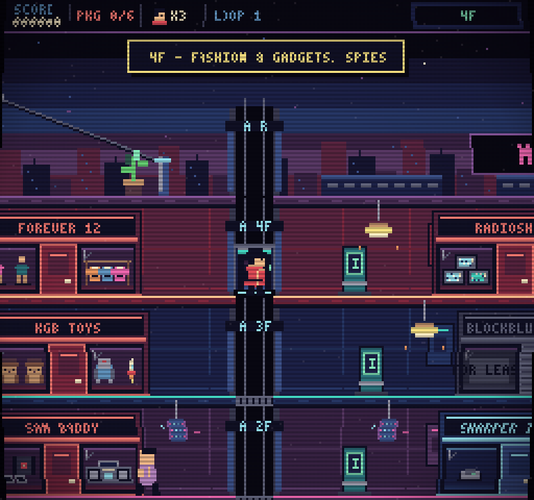
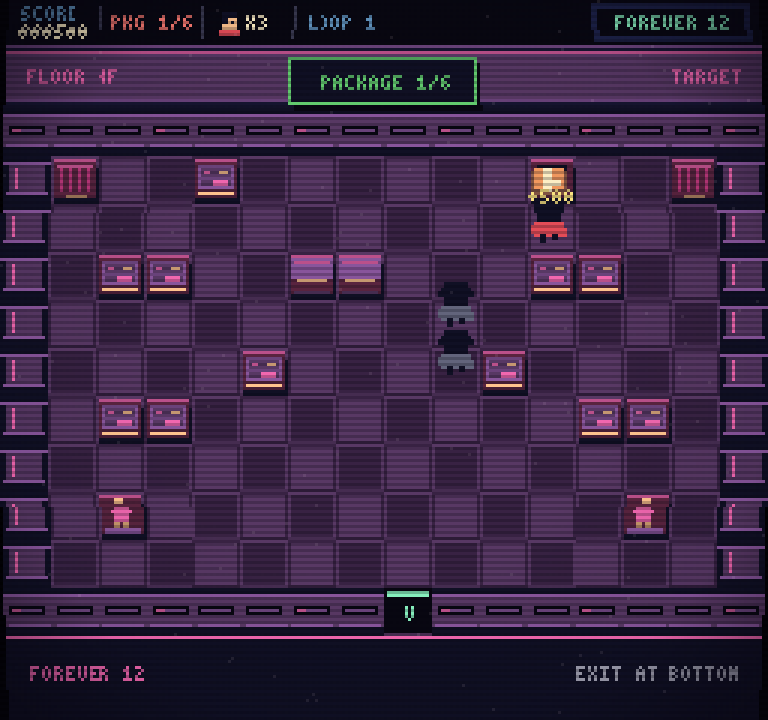

# Mall Action

**A shopping mall espionage caper by FLICKERSOFT.** Zipline onto the roof,
rummage for six packages in a very suspicious 1980s mall, then escape in your
wood-panelled station wagon. The mall gets meaner on each loop.

[**Play in your browser**](https://rlorca.github.io/mall-action/gpt-6.2-sol-xhigh/)

<kbd></kbd>
<kbd></kbd>
<kbd></kbd>
<kbd></kbd>

## Features

- Six floors of side-scrolling mall action with three elevators, two escalators,
  thirteen animated storefronts, and ten top-down shops.
- One hidden package in each red-door shop. Blue doors lead to supplies.
  Search fixtures for gear, secrets, traps, and items of questionable value.
- Working fountains, wet floors, disco balls, a photo booth, security patrols,
  a local newspaper, and SPYGRAM.
- A 256×240 pixel display, an optional CRT effect, and original chiptunes.
  Sprites, lettering, music, and effects are generated from source.
- Seeded game rules, keyboard and controller support, three continues, and a
  secret title-screen code.

## Controls

| Action | Keyboard | Standard gamepad |
| --- | --- | --- |
| Move | Arrows or WASD | D-pad or left stick |
| Shoot | Z or J | A |
| Jump / search | X, K, or Space | B |
| Floor directory | Shift or Tab | Select |
| Start / pause / confirm | Enter | Start |
| Toggle CRT | C | |
| Toggle sound | M | |

Stand beside a shaft and tap Up or Down to call the car. Once inside a manual
car, hold a direction and release before the desired floor. Left and Right
step out when the doors open. The two escalators run between 4F and 3F and
between 2F and 1F. Elevator B goes to parking.

In a store, stand alongside a fixture and tap search once. Give the progress
bar time to fill. A new direction or a shot interrupts it. Red doors go dark
after their package is collected. The floor directory shows how many target
doors are still active. Kiosks point to the nearest remaining package.

## Run locally

Node.js 22 or later is sufficient. The game has no package dependencies.

```sh
npm ci
npm run dev
npm test
npm run build
```

The dev server listens at `http://127.0.0.1:5173`. The production build is in
`dist/` and can be hosted under any path. For a local sub-path check, build,
start the dev server, and open `http://127.0.0.1:5173/dist/`.

| URL option | Effect |
| --- | --- |
| `?seed=1986` | Set the deterministic seed |
| `?debug=1` | Skip the splash and expose `window.__mallAction` |
| `?gallery=1` | Show the in-engine animated sprite gallery |

In debug mode, read `window.__mallAction.state` and call
`window.__mallAction.suspend()` to pause real-time updates. Then call
`window.stepGame(30, ['right', 'a'])` to advance thirty 60 Hz frames.
Button presses are derived from changes between calls. Use
`window.stepGame(1, [])` to release the simulated pad, and
`window.__mallAction.suspend(false)` to resume the live game.

## Project layout

| Path | Contents |
| --- | --- |
| `src/engine.js`, `src/rules.js` | Scene state, scoring, lives, difficulty and powers |
| `src/mall.js`, `src/store.js`, `src/data.js` | Movement, AI, layout, and interactions |
| `src/copy.js` | Jokes, PA announcements, SPYGRAM posts, store dialogue, headlines and inventory items |
| `src/art.js`, `src/pixel.js`, `src/draw*.js` | Sprite generation, pixel fonts, and scene drawing |
| `src/audio.js`, `src/video.js` | Four-channel sound synthesis and CRT presentation |
| `src/splash/` | Reusable FLICKERSOFT animation |
| `test/` | Rule tests and a full seed-1986 pad-input playthrough |
| `.github/workflows/pages.yml` | Test, build, and publish the benchmark branch |

For a new joke, edit [the copy catalogue](src/copy.js) and run the copy-fit
tests. Speech bubbles have 28 characters, SPYGRAM caption and comment lines
have 21, and newspaper lines have 26.

Mall Action is a FLICKERSOFT fan homage. It is unaffiliated with Taito and the
brands it parodies.

## Benchmark notes

- Model and effort are **GPT-6.2-Sol, xhigh**. Run on November 17, 2026 in
  the Codex API workspace with Node.js and Playwright Chromium. Implementation
  and verification took roughly half an hour.
- One-shot implementation from the supplied prompt on an independent branch.
  Other implementations were outside the run. The harness granted access to
  create the orphan branch and bind the local test server.
- The real-time browser route used ordinary keyboard input through the first
  package. Later browser scenarios used debug checkpoints. The deterministic
  pad-input replay completes all six shops and reaches loop two.
- The workflow targets this implementation branch so the benchmark's main
  branch can keep the shared brief and index.
