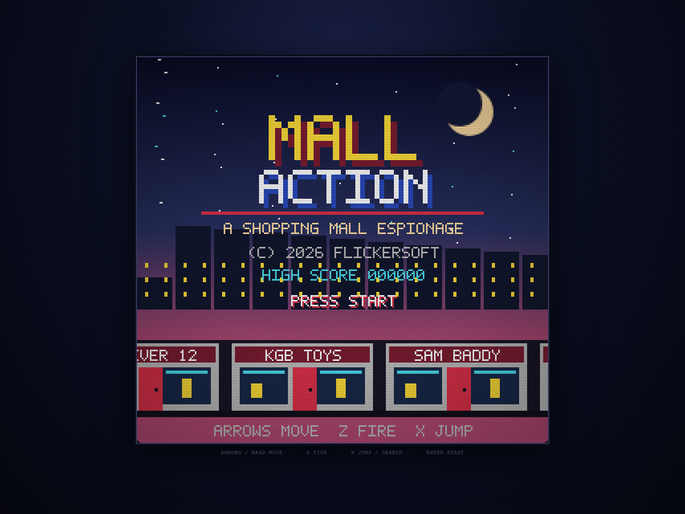
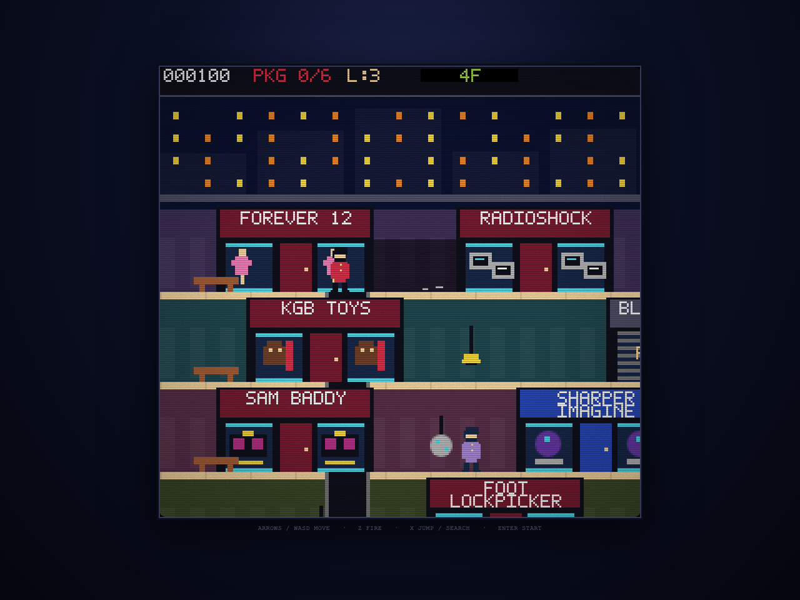
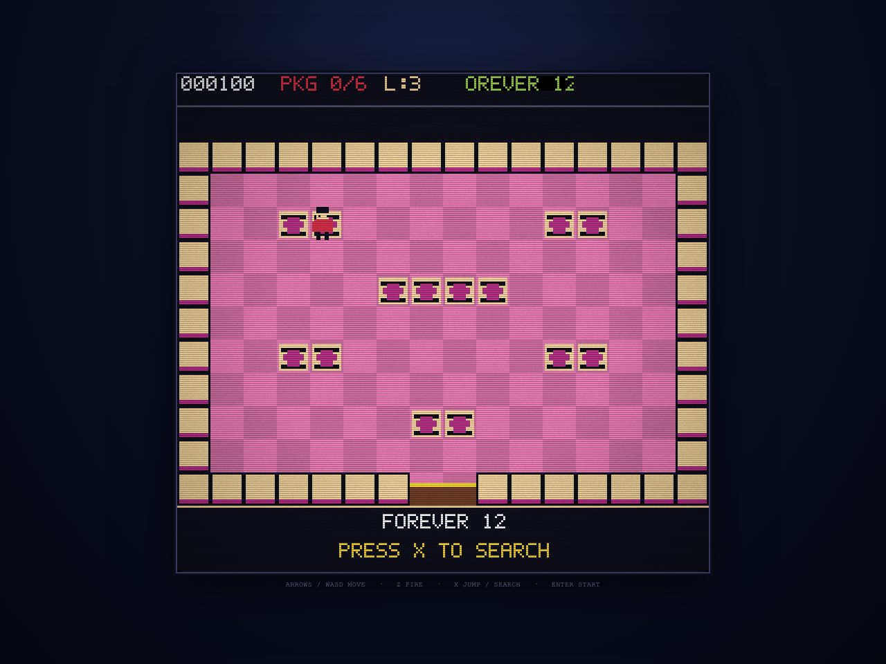
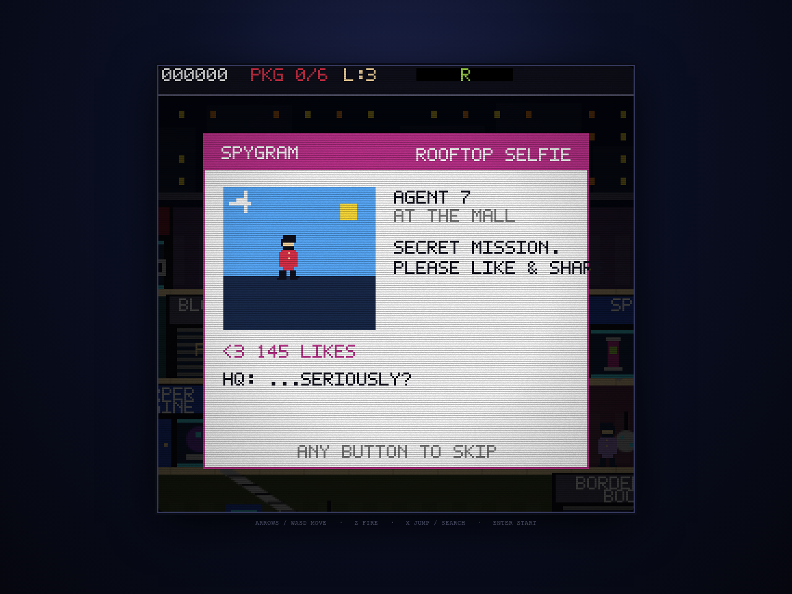

# MALL ACTION

**An 8-bit shopping-mall espionage caper by FLICKERSOFT.** Zipline onto an 80s mall, recover six suspicious packages, dodge fedora-wearing spies, and escape in a wood-panelled station wagon. A spiritual successor to *Elevator Action*, with top-down store raids, questionable retail puns, and an unnecessary amount of SPYGRAM.

## Play in your browser

**[Play MALL ACTION](https://rlorca.github.io/mall-action/kimi-k3.1-pro-high/)**

The game is entirely static. No account, server, installation, external art, or audio files are needed. Audio starts after your first input, as required by browser autoplay rules.



## Features

- A 768-pixel, six-floor side-scrolling mall with manual and automatic elevators, escalators, shaft pits, car roofs, and crushing hazards.
- Ten open stores with distinct room layouts and visual themes, plus three shuttered has-beens. Six target stores each hide exactly one package.
- Forgiving top-down searching: touch any side of a fixture, tap once, and let the search finish. Opened fixtures stay open when you return.
- Telegraphing spies, three-hit security bots, mall walkers, a janitor, wet floors, fountains, a Segway mall cop, photo booth, and directory kiosks.
- Rapid Fire, Spread Shot, armour, speed, Radar, food, joke items, and a once-per-game retro-cave easter egg.
- Falling lamps, rolling disco balls, wind-up toy shelves, a listening booth, and fitting-room surprises.
- Full game flow: reusable FLICKERSOFT splash → title → zipline/selfie → mall and stores → getaway → tally, newspaper and SPYGRAM → harder loops. Includes three continues and game over.
- Original browser-synthesised pulse, triangle and noise audio; generated bitmap font and sprite art; seeded deterministic game rules.
- Optional CRT scanlines, vignette, noise and subtle curvature. It is on by default and remembers your choice.
- Keyboard and gamepad input, a 256×240 pixel display with integer nearest-neighbour scaling, and a fixed 60 Hz simulation.

| Mall and directory | Store raid | Mission selfie |
|---|---|---|
|  |  |  |

## Controls

| Action | Keyboard | Gamepad |
|---|---|---|
| Move / ride / enter | Arrow keys or WASD | D-pad or left stick |
| **A** — shoot | Z or J | Button 0 / A |
| **B** — jump in mall, search in stores | X, K, or Space | Button 1 / B |
| **Select** — mall directory | Shift or Tab | Button 8 / Select |
| **Start** — pause / confirm | Enter | Button 9 / Start |
| CRT on/off | C | — |
| Sound on/off | M | — |

Letter bindings follow the **printed letter**, so WASD and action keys work on QWERTY, QWERTZ, and AZERTY. Arrow keys and other non-letter controls use their physical positions.

**Secret:** the classic ↑↑↓↓←→←→ B A code on the title screen starts Black Friday Mode. Extra leading Ups are forgiven.

## Tips for new agents

1. From the roof, walk right to elevator **A** or wait for automatic elevator **C**. Elevator **B** is the only route to parking.
2. Red doors hide packages; blue doors lead to power-up shops. Dark target doors are already cleared. Shift opens the directory.
3. Spies raise a visible warning before firing. Duck under high shots, but move away from low ones. A moving jump is a jump-kick.
4. In a store, stand touching a fixture and tap X once. Shooting or a fresh direction cancels a search; simply holding X does not chain searches.
5. Shoot hanging lamps when a spy is underneath. On 2F, mind the rolling disco ball. Fountains can cough up coins—and rarely a gold 1-Up.
6. After collecting all six packages, take B to **P**, stand by the wagon, and press Up.

## Run, test, and build

Node.js 22 or newer is recommended.

```sh
npm ci
npm run dev       # Vite development server
npm test          # deterministic rule and content tests
npm run build     # static production files in dist/
npm run preview   # serve the production build
```

Vite uses `base: "./"`, so the production build works at the domain root or under a nested GitHub Pages path. The workflow in `.github/workflows/pages.yml` runs tests and the production build before publishing; a failure blocks deployment.

### Debug URLs

- `?seed=42` — repeatable game logic and room contents.
- `?debug=1` — skip the studio splash and expose `window.mallAction` / `window.__MALL_ACTION__`.
- `?gallery=1` — animated generated-sprite gallery.
- Options can be combined, for example `?debug=1&seed=42`.

The debug context contains `game`, `state`, `renderer`, `pad`, `audio`, and `step(frames, heldButtons)`. Example:

```js
mallAction.step(60, { right: true });
mallAction.step(1, { b: true });  // fresh B edge
mallAction.step(45, {});
```

### Real-browser playtest

`scripts/browser-playtest.mjs` drives Chrome in real time through arrival, an elevator, an escalator, combat, a store package, map, pause, level clear, continue, and game over. It also checks that CRT is on and captures screenshots.

With Vite running on port 4173 and Chrome running with `--remote-debugging-port=9222`:

```sh
node scripts/browser-playtest.mjs
```

Set `MALL_URL` to test a deployed or nested-path build instead.

## Project layout

```text
src/
  core/          Pure game rules, seeded RNG, input, physics, rooms and scoring
  render/        Canvas renderer, generated bitmap font and sprite pipeline
  splash/        Reusable FLICKERSOFT ident and its README
  audio.js       Web Audio pulse / triangle / noise synthesis
  main.js        DOM adapter, fixed-step loop, resizing, persistence and debug API
test/            Vitest rule, content and input suites
scripts/         Real-time Chromium playtest
screenshots/     Actual captured browser frames
```

Add or edit jokes in **`src/core/copy.js`**. Tests check speech-bubble, SPYGRAM, comment, and headline line lengths.

## Notes for contributors

See [`AGENTS.md`](AGENTS.md) for architecture, invariants, and verification rules. Implementation trade-offs are recorded in [`DECISIONS.md`](DECISIONS.md).

---

*A FLICKERSOFT fan homage. Not affiliated with Taito or any parodied brand. All storefront names are parodies; no real logos, trade dress, external art, external audio, or copyrighted melodies are used.*
